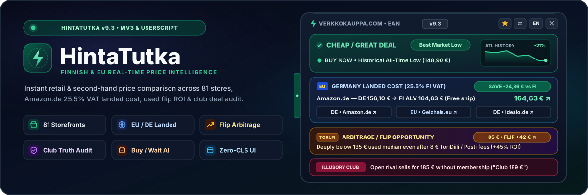
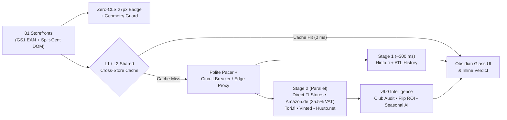

<div align="center">



<br />

[](https://github.com/FIMARx/hintatutka/releases/latest)
[](https://github.com/FIMARx/hintatutka/actions/workflows/test.yml)
[](https://github.com/FIMARx/hintatutka/releases)
[](#-supported-stores-81)
[](https://github.com/FIMARx/hintatutka/blob/main/HintaTutka.user.js)
[](https://github.com/FIMARx/hintatutka/stargazers)
[](#-license)

<p>
  <a href="#-quick-install--download-telemetry"><b>📦 Install &amp; Downloads</b></a> •
  <a href="#-core-intelligence-engines-v90"><b>✨ v9.0 Engines</b></a> •
  <a href="#-architecture--shield-pipeline"><b>🏗️ Architecture</b></a> •
  <a href="#-supported-stores-81"><b>🏪 81 Stores</b></a> •
  <a href="#-suomenkielinen-pikaopas"><b>🇫🇮 Suomeksi</b></a> •
  <a href="#-changelog"><b>🗺️ Changelog</b></a>
</p>

</div>

---

## 📦 Quick Install & Download Telemetry

<div align="center">

| 📊 Live Download Telemetry | ⚡ Option A: Userscript (Recommended) | 🧩 Option B: Native MV3 Extension |
| :---: | :---: | :---: |
| [](https://github.com/FIMARx/hintatutka/releases)<br />[](https://github.com/FIMARx/hintatutka/releases/latest)<br /><sub>Tracked live via GitHub Releases API</sub> | [](https://github.com/FIMARx/hintatutka/releases/latest/download/HintaTutka.user.js)<br />[](https://github.com/FIMARx/hintatutka/releases/latest)<br /><sub>1-click install for <b>Tampermonkey</b> &amp; <b>Violentmonkey</b></sub> | [-8b5cf6?style=for-the-badge&logo=googlechrome&logoColor=white)](https://github.com/FIMARx/hintatutka/releases/latest/download/HintaTutka-MV3-Extension.zip)<br />[](https://github.com/FIMARx/hintatutka/releases/latest)<br /><sub>Off-main-thread Service Worker for <b>Chrome / Edge / Brave</b></sub> |

</div>

### Step-by-Step Setup

1. **⚡ Userscript (`Tampermonkey` / `Violentmonkey` — Chrome, Firefox, Edge, Brave, Safari)**
   - Install [Tampermonkey](https://www.tampermonkey.net/) or [Violentmonkey](https://violentmonkey.github.io/).
   - Click **[Install `HintaTutka.user.js`](https://github.com/FIMARx/hintatutka/releases/latest/download/HintaTutka.user.js)** (or [Direct Raw Mirror](https://raw.githubusercontent.com/FIMARx/hintatutka/main/HintaTutka.user.js)) and confirm **Install**.
   - Open any product page on Verkkokauppa.com, Gigantti, Power, Jimm's, Prisma, XXL, Tori.fi, or 70+ other stores!

2. **🧩 Native Manifest V3 Browser Extension (`extension-mv3/`)**
   - Download **[`HintaTutka-MV3-Extension.zip`](https://github.com/FIMARx/hintatutka/releases/latest/download/HintaTutka-MV3-Extension.zip)** and extract it to a folder *(disable the Tampermonkey script first so you don't run two copies at once)*.
   - Open `chrome://extensions` (or `edge://extensions` / `brave://extensions`) and toggle **Developer mode** ON.
   - Click **Load unpacked** and select the extracted folder.
   - **Auto-Updates & Hot-Patches**: Store CSS selectors ([`selectors.json`](selectors.json)) auto-update silently every 12h. When a new engine release ships, the toolbar icon lights up with a **`NEW`** badge — run the included `update-extension.ps1` (Windows) or `update-extension.sh` (macOS/Linux) script to update files in 1 click, then click `↻` in `chrome://extensions`.

3. **☁️ Optional: Self-Hosted Cloudflare Worker Edge Proxy (`cloudflare-worker/`)**
   - Masks your client IP behind Cloudflare's global network, shares a **15-minute edge cache** (`caches.default`), and exposes `/proxy`, `/selectors`, and a custom SVG telemetry card at `/stats-card.svg`:
     ```bash
     cd cloudflare-worker
     npx wrangler deploy
     ```
   - Paste your `https://hintatutka-proxy.<account>.workers.dev` URL into the MV3 Extension popup or Tampermonkey's **`☁️ HintaTutka: Serverless Proxy URL`** menu command. If unreachable, HintaTutka automatically falls back to direct fetching.

---

## ✨ Core Intelligence Engines (v9.0)

| Engine | What It Does |
| :--- | :--- |
| **🇪🇺 EU Cross-Border & Finnish VAT Optimizer** | Queries **Amazon.de** live by GS1-validated EAN or model code, strips sponsored/bundle traps, and calculates exact **delivered cost to Finland**: `DE Price × (1.255 / 1.19) + FI Shipping` (`0 €` when `≥ 99 €`, else `10.49 €`; `14% / 7%` for books). Exposes the *"Suomi-lisä"* markup and adds 1-click **Amazon.de**, **Geizhals.eu**, and **Idealo.de** buttons. |
| **🔥 Second-Hand Arbitrage & Flip Engine** | Aggregates **Tori.fi**, **Vinted.fi**, and **Huuto.net** in real time, filters `1 €` / accessory noise via **Tukey IQR**, and flags deeply underpriced listings with **`🔥 FLIP +XX €`** net-profit badges after deducting `~5%` (min `8 €`) shipping & buyer-protection fees. |
| **🎭 Club Price Truth Benchmarking** | Audits loyalty deals (`MyPOWER`, `Klubihinta`, `HH PLUS`, `Asiakasomistaja`) against open non-club competitors and historical **ATL** — exposing **`🎭 ILLUSORY CLUB DEALS`** (where a rival matches/beats the club price without membership) and **`⚠️ INFLATED NORMAL PRICES`** (`> 8.5%` anchor markup) vs. **`🏆 TRUE CLUB MARKET LOWS`**. |
| **🔮 Predictive Analytics & Seasonal AI** | Combines ATL/ATH range percentile, 6-interval linear regression price momentum (`📉 Falling`, `📈 Rising`, `➡️ Stable`), and the **Finnish Retail Seasonal Calendar** (*Tammiale, Spring/Autumn Hullut Päivät, Juhannus/Kesäale, Back to School, Singles' Day 11.11, Black Week / Black Friday, Välipäiväale*) to advise **`🟢 BUY NOW`** vs. **`⏳ WAIT X DAYS`**. |
| **🛡️ Zero-CLS & Anti-Rate-Limit Shield** | Pre-reserves a fixed `27px` (`contain: layout style`) inline verdict slot before network calls for **0 layout shift**, defers execution in unopened background tabs (`visibilityState`), shares a 2-tier L1/L2 cache across all 81 domains, paces per-host requests with jitter + Cloudflare/`429` circuit breakers, and hot-patches store selectors from [`selectors.json`](selectors.json). |
| **🛒 Smart Everyday Shopping Suite** | Includes **⭐ Price Watchlist** (no login), **🤝 Bargaining Advisor** (1-click polite counter-offer copy for Tori/Vinted/Huuto), **⚔️ 2-Column Side-by-Side Model Compare**, **💳 5% S-Bonus & K-Plussa Cashback**, **⚖️ Unit-Price Analyzer (`€/kg`, `€/l`)**, **🧠 Self-Learning Search Memory**, and **FI / EN** UI toggle. |

---

## 🏗️ Architecture & Shield Pipeline



---

## 🧪 Automated Testing & Real-Time Verification Suite

HintaTutka includes a testing and real-time verification environment patterned after the DigiKaveri project. Built on Node's native `node:test` runner with **zero external testing dependencies**, tests execute in milliseconds locally and continuously in GitHub Actions CI.

```bash
# Run all unit, precision, parser, algorithm, cache & guard tests (< 1 second)
npm test

# Run the master verification suite with live real-time store canaries
npm run verify

# Run quick verification (offline tests only)
npm run verify:quick

# Run real-time live store checks against live storefront search endpoints
npm run test:realtime
```

### Safety Nets & Test Coverage

| Suite | File | What It Protects |
| :--- | :--- | :--- |
| **🛡️ Tripwire Guards** | [`tests/guards.test.js`](tests/guards.test.js) | Enforces **100% byte synchronization** between `HintaTutka.user.js` and `extension-mv3/hintatutka-core.js`, version parity across manifests, strict JSON schema validation for [`selectors.json`](selectors.json), valid SVG layout, and zero local developer path leaks. |
| **🎯 Precision Matrix** | [`tests/precision.test.js`](tests/precision.test.js) | Prevents cross-generation & cross-tier mismatches: iPhone 18 Pro vs. iPhone 17 / 16 / 18 Pro Max, motherboard form-factor shields (`B850M-PLUS` micro-ATX vs `B850-PLUS` ATX), GPU tiers (`RTX 4070 Super` vs base / Ti), CPU architectures (`7800X3D` vs `9800X3D`), and storage variants. |
| **💶 Store DOM Parsers** | [`tests/parsers.test.js`](tests/parsers.test.js) | Verifies Finnish thousands spaces (`1 509,00 €`), non-breaking spaces (`1\u00a0659,00\u00a0€` in Prisma), German dot decimals (`1.043,02 €`), 25.5% Finnish VAT landed calculations, rejection of installment prices (`39,00 €/kk`), and illusory club deal auditing. |
| **🔥 Algorithms & AI** | [`tests/algorithms.test.js`](tests/algorithms.test.js) | Verifies Tukey IQR second-hand price outlier filtering, flip arbitrage ROI math, and Finnish seasonal discount calendar forecasting (*Tammiale, Hullut Päivät, Black Friday*). |
| **⚡ Cache Isolation** | [`tests/cache.test.js`](tests/cache.test.js) | Ensures version-isolated namespaces (`ufhpc_v94_`), automatic legacy cache purging on boot, and TTL enforcement. |
| **🌐 Real-Time Live Canaries** | [`tests/realtime.mjs`](tests/realtime.mjs) | Fires live network queries against Amazon.de and Finnish storefronts to verify that precision shields actively discard live search engine false positives and catch storefront DOM changes in real time. |

---

## 🏪 Supported Stores (81)

HintaTutka works across all localized store paths (`/fi/`, `/en/`, `/sv/`) and Single-Page Applications (History API hooks):

| Category | Supported Storefronts |
| :--- | :--- |
| **Electronics & Appliances** | Verkkokauppa.com, Gigantti, Power, Veikon Kone, Euronics, HobbyHall, Bigbox |
| **PC Hardware & Gaming** | Jimm's, Proshop, Datatronic, Multitronic, Tietokonekauppa.fi, Data-Systems, Komponenttikauppa.fi, Cruzbroker, MaxGaming, VPD, Puolenkuun Pelit, Kasuplan, Mikromafia, TeraStore, DigiDreamer, CS Megastore |
| **Refurbished Tech** | Swappie, Taitonetti, Fonum |
| **Sports & Outdoor** | XXL, Intersport, Budget Sport, Varuste.net, Scandinavian Outdoor, Stadium, Partioaitta, Haglöfs |
| **Price Aggregators & EU** | Hinta.fi, Hintaseuranta.fi, Amazon.de *(+ 1-click Geizhals.eu & Idealo.de)* |
| **Pharmacy, Beauty & Pets** | Yliopiston Apteekki (`ya.fi`), Lyko, Kicks, Musti ja Mirri, Zooplus, Peten Koiratarvike |
| **Groceries & Everyday** | S-kaupat.fi *(Prisma, S-market, Alepa, Sale)*, K-Ruoka.fi *(K-Citymarket, K-Supermarket, K-Market)*, Fiksuruoka, Matsmart, Ruohonjuuri, Tokmanni, Puuilo |
| **Furniture, Home & Books** | IKEA, JYSK, Sotka, Asko, Masku, Isku, Veke, Finnish Design Shop, Stockmann, Rusta, Clas Ohlson, Adlibris, Suomalainen Kirjakauppa |
| **DIY, Hardware & Auto** | K-Rauta, Taloon.com, Netrauta, Bauhaus, Motonet, Biltema, Prisma, Kärkkäinen, Dustin / DustinHome, e-ville, SatShop, Jula |
| **Telecom Carriers** | Elisa, Telia, DNA |
| **Second-Hand Marketplaces** | Tori.fi, Vinted.fi, Huuto.net *(both inside retail sidebars and directly on second-hand item pages)* |

---

## 🇫🇮 Suomenkielinen pikaopas

**HintaTutka v9.0** tuo reaaliaikaisen hintavertailun, käytettyjen markkinat ja EU-hintalaskurin suoraan **81 verkkokaupan** tuotesivuille:

- **Välitön hintatuomio sivulla (0-CLS)**: Näet suoraan kaupan hinnan vieressä, onko tuote **🟢 Edullinen**, **🟡 OK** vai **🔴 Kallis** (euro- ja prosenttierolla halvimpaan kauppaan).
- **🇪🇺 EU / Saksa "Suomi-lisä" -laskuri**: Tarkistaa **Amazon.de**-hinnan, muuntaa Saksan `19 %` ALV:n Suomen `25,5 %` ALV-kantaan ja lisää Suomi-toimituksen (`0 €` yli `99 €` tilauksille, muuten `10,49 €`).
- **🔥 Arbitraasi- & Flip-moottori (`Tori.fi`, `Vinted`, `Huuto.net`)**: Merkitsee käytettyjen markkinoilta selvästi alihinnoitellut löydöt **`🔥 FLIP +XX €`** -tunnisteella (toimitus- ja turvakulujen jälkeen) ja tarjoaa **🤝 Tinkausapurin** valmiilla viestipohjalla.
- **🎭 Klubihintojen totuusmittari**: Paljastaa **`🎭 Näennäisalet`** (kun kilpailija myy tuotetta halvemmalla *ilman* jäsenyyttä) ja **`⚠️ Korotetut normaalihinnat`**, sekä vahvistaa aidot **`🏆 Klubipohjahinnat`**.
- **🔮 Hintaennuste & Suomen alekalenteri**: Yhdistää hintahistorian regressiotrendin ja suomalaiset alekaudet (*Tammiale, Hullut Päivät, Juhannusale, Back to School, Singles' Day, Black Week, Välipäiväale*) kertoen kannattaako **🟢 Ostaa nyt** vai **⏳ Odottaa**.
- **Asennus 10 sekunnissa**: Asenna [Tampermonkey](https://www.tampermonkey.net/) ja klikkaa **[Asenna `HintaTutka.user.js`](https://github.com/FIMARx/hintatutka/releases/latest/download/HintaTutka.user.js)** — tai lataa natiivi Chrome/Edge/Brave-laajennus **[`HintaTutka-MV3-Extension.zip`](https://github.com/FIMARx/hintatutka/releases/latest/download/HintaTutka-MV3-Extension.zip)**.

---

## 🗺️ Changelog

### 🚀 v9.8
- **🖥️ PC Build & Hardware Component Bundle Deconstruction Engine**: Intelligent parser that detects, breaks down, and analyzes prebuilt gaming PCs (e.g., Jimm's GtG Owl 5090) and hardware upgrade packages (e.g., TUF B850-PLUS + 9800X3D + 32GB RAM) into their individual components: CPU, Motherboard, GPU, RAM, Storage (SSD), Cooler, Case, Power Supply, and OS.
- **💰 DIY vs. Prebuilt Math & Standalone Savings Breakdown**: Dynamically compares the package price against the sum of buying parts individually, showing verified savings (`🔥 TUOTEPAKETIN SÄÄSTÖ (-49,80 € / -4.2%)`) or warning when buying parts separately is cheaper (`⚠️ ERIKSEEN OSTETTUNA HALVEMPI`).
- **🔗 1-Click Component Price Check Hub**: Each deconstructed component card provides 1-click links to its product page, custom Hinta.fi market search, and retailer search for instant price comparison across Finland.
- **🛡️ Hard-Conflict Anti-False-Match Shield**: Strictly stops multi-part bundles or prebuilt PCs from matching against single standalone motherboard or CPU listings on Hinta.fi (`delta -= 160; hasHardConflict = true; score -= 350;`).
- **⚡ v98 Isolated Cache Namespace**: Automatic legacy cache eviction and zero-leak storage isolation across all 81 stores.

### 🚀 v9.7 (Latest)
- **🎨 Complete Professional GUI/UX Overhaul**: Completely redesigned the sidebar into a sleek, dark glassmorphic terminal inspired by Linear, Apple, and professional financial analytics.
- **🙈 Edge Handle Visibility Fix**: The dock handle tab (`.ufhpc-handle`) is now cleanly hidden whenever the sidebar is open, eliminating the awkward tab sticking out to the left. The open panel's top header bar is now vertically draggable (`cursor: grab`) to reposition anywhere on screen.
- **✨ Conflict-Free Timing Banners**: Suppressed contradictory stacked banners (`TOO EXPENSIVE` stacked on top of `BUY NOW`). When the current store is expensive, market ATL/timing is integrated smoothly into the Lowest New metric box (`🟢 Markkinapohja ATL • 📉 Laskeva ❯`) and detailed on the Price History tab.
- **📊 Unified Financial Store Table**: Replaced 14 bulky box cards with a single sleek table container featuring hairline dividers, glowing stock indicators, tabular monospace prices, and crisp `.ufhpc-here-tag` ("Täällä / Here") and `.ufhpc-lowest-tag` ("🏆 Halvin / Lowest") pills.
- **💊 Apple / Linear Segmented Pill Tabs**: Frosted glass tab track with rounded count badges (`Kaupat [14]`, `Käytetyt [2]`, `Hintahistoria`).
- **🔍 Spotlight-Style Search Bar**: Redesigned search bar with embedded SVG magnifying glass lens, focus ring, and glass action button.

### 🚀 v9.6
- **🔥 Automated Resale Arbitrage Bot (`scripts/arbitrage-bot.mjs`)**: Headless scraper using Tukey IQR outlier filtering and flip ROI margin math (`🔥 FLIP +XX €`), running locally or on GitHub Actions (`.github/workflows/arbitrage-bot.yml`) with instant rich Discord webhook push notifications.
- **🇪🇺 True EU Cross-Border Sourcing & "Suomi-lisä" Index (`scripts/suomi-lisa-tracker.mjs`)**: Automated cross-border tracker comparing domestic Finnish prices vs. Amazon.de landed cost (with 25.5% Finnish VAT adjustment) across product categories, generating [`data/suomi-lisa-index.json`](data/suomi-lisa-index.json) and [`data/SUOMI-LISA-INDEX.md`](data/SUOMI-LISA-INDEX.md) to pinpoint domestic price traps.
- **☁️ True Micro-Caching (SWR) in Cloudflare Worker (`cloudflare-worker/worker.js`)**: Structured Stale-While-Revalidate caching layer (`max-age=600, stale-while-revalidate=3600`) returning instantaneous 0ms cached responses while silently revalidating prices in the background via `ctx.waitUntil`.
- **📈 Holt-Winters Seasonal Exponential Smoothing**: Triple exponential smoothing engine capturing smoothed baseline level, trend momentum, and cyclic retail dips (Hullut Päivät, Black Week) directly in the client script and edge proxy (`/forecast`).
- **🇩🇪 GS1 EAN Structural Matching & German Hardware Synonyms**: Bypasses string word filters on verified GS1 EAN Amazon.de searches when no spec conflict exists, plus German hardware vocabulary (`tastatur`, `grafikkarte`, `hauptplatine`, `prozessor`, `netzteil`, `gehäuse`, `maus`).
- **🩹 Self-Healing DOM Selectors Engine (`scripts/heal-selectors.mjs`)**: Daily automated GitHub Action (`.github/workflows/self-heal-selectors.yml`) testing selectors across stores, synthesizing fallback selectors using relative currency heuristics, and auto-patching [`selectors.json`](selectors.json).

### 🚀 v9.5
- **🧪 DigiKaveri-Grade Testing Suite & Real-Time Store Canaries**: Built on native `node:test` (22 unit, precision, parser, algorithm & cache tests + live network canaries) with automated CI on push, PR, and daily schedule (`cron: '0 6 * * *'`).
- **🛡️ Motherboard Form-Factor Token Shield (`B850M` vs `B850`)**: Upgraded generation token regex to capture 3-digit chipsets (`B850M`, `B850`, `B650M`, `X870E`, `Z890`) and flag hard spec conflicts between micro-ATX and standard ATX boards.
- **💶 Finnish Unicode Word Boundary Fix (`erissä 29,90 €`)**: Replaced ASCII `\b` with unicode-safe boundary `(?![a-zA-Z0-9äöåÄÖÅ])` across `invalidPriceTextRx` and `exVatOrInstallmentRx` to reject installment text.
- **⚡ Dynamic Legacy Cache Purging**: Upgraded `purgeLegacyCaches()` to dynamically evict all legacy `ufhpc_` versions (`ufhpc_v94_` and below) to `ufhpc_v95_`.

### 🚀 v9.4
- **🛡️ Cross-Border EU Cache Invalidation & Stale Model Eviction**: Bumped cache keys to `v94`, purged obsolete GM/session storage entries from previous sessions, and added automatic validation of cached EU results against current target product specs (evicting stale cross-generation entries like `iPhone 17` when browsing `iPhone 18 Pro`).
- **🔒 Render-Time EU Card Suppression Guard**: Added a fail-safe render-time compatibility check in `renderResult` ensuring that if an EU cross-border item has a hard spec conflict or word mismatch, the card is suppressed and falls back to clean 1-click manual search hub links (`Amazon.de ↗`, `Geizhals.eu ↗`, `Idealo.de ↗`).

### 🚀 v9.3
- **🎯 Strict Generation & Tier-Modifier Parity (`iPhone 18` vs `18 Pro` vs `18 Pro Max` vs `17` / `17e`)**: Enforces hard conflict rejection across generations, sub-variants (`17` vs `17e`, `Pixel 9` vs `9a`), and model tiers (`Pro`, `Max`, `Ultra`, `Plus`, `Air`, `Mini`, `Ti`, `Super`, `X3D`), plus `1000 GB ↔ 1 TB` normalization and Hinta.fi `<title>` storage enrichment.
- **💶 Thousands-Separator Price Parser Fix (`≥ 1 000 €`)**: Fixed space/`&nbsp;` thousands-separator truncation on Prisma, Vinted, and Clas Ohlson (`1 659,00 €` / `1 509,00 €` no longer truncating to `659,00 €` / `509,00 €`).
- **🇩🇪 Amazon.de Multi-`<h2>` Title, EAN Fallback & `.priceToPay` Active Price Fix**: Combines brand + product `<h2>` headers (fixing `"Apple"` 1-word matches), enforces model/generation verification on EAN fallback results, detects `Deliver to Finland` to prevent double 25.5% VAT calculation, and reads `.priceToPay` (`€1,043.02`) instead of strikethrough `RRP` (`€1,159.03`).

### 🚀 v9.2
- **⚡ Critical Loading Fix (`isValidBarcodeChecksum`)**: Fixed an uncaught `ReferenceError` when rendering products with GS1 EAN barcodes (`buildEuHubLinks` / `fetchAmazonDeCrossBorder`) that froze the Tampermonkey sidebar and inline `◈ Tarkistetaan...` badge on loading.
- **🛡️ Anti-Hang Watchdog & Stage-2 Timeouts**: Hardened `executeRawGmGet` (`onabort` + JS watchdog timer), `acquirePoliteHostSlot` (12s auto-releasing slot lease), Stage-2 parallel scraper timeouts, and `runPriceChecker` error recovery so stalled network calls can never freeze the UI.
- **🎨 Squircle Radar-Bolt Brand Logo**: Added standalone vector [`assets/logo.svg`](assets/logo.svg), 64× supersampled `icon16`/`32`/`48`/`128.png` extension icons, `popup.html` brand header, Tampermonkey `@icon` metadata, and inline sidebar emblem.

### 🚀 v9.1
- **🔔 Smart MV3 Extension Update System & 1-Click Updater**: Background GitHub version watcher with automatic emerald **`NEW`** toolbar icon badge (`chrome.action.setBadgeText`), MV3-aware download banners/popup UI, on-demand `selectors.json` hot-patch button, and 1-click in-place `update-extension.ps1` / `update-extension.sh` scripts.
- **🎨 Studio-Grade Vector Hero Banner & Live Download Telemetry**: Rebuilt [`assets/hero-banner.svg`](assets/hero-banner.svg) with custom geometric vector icons, mini price-history sparkline, and automated GitHub Release asset packaging ([`.github/workflows/release.yml`](.github/workflows/release.yml)).

### 🚀 v9.0
- **🇪🇺 Cross-Border EU Shipping & Finnish VAT Landed-Cost Optimizer**: Live `Amazon.de` lookup (`19% MwSt → 25.5% FI ALV` + `99 €` free FI shipping threshold), US/UK comma-thousands price parser fix (`€1,181.28`), and 1-click **Amazon.de**, **Geizhals.eu**, and **Idealo.de** buttons.
- **🔥 Arbitrage & Flipping Engine**: Net resale margin & ROI calculator across **Tori.fi**, **Vinted.fi**, and **Huuto.net** (`🔥 FLIP +XX €` row tags + Arbitrage Opportunity cards).
- **🎭 Club Price Truth Benchmarking**: Audits `MyPOWER`, `Klubihinta`, `HH PLUS`, and `Asiakasomistaja` deals against open non-club stores and historical ATL (`🏆 True Club Low` vs. `🎭 Illusory Club Deal` vs. `⚠️ Inflated Normal Price`).
- **🔮 Historical Predictive Analytics & Seasonal Buy/Wait Engine**: 6-point linear regression trend + 8-event Finnish retail sale calendar (`🟢 BUY NOW` / `⏳ WAIT`).
- **☁️ Decoupled Serverless Edge Proxy (`cloudflare-worker/`)**: Cloudflare Worker with strict allowlist, 15-min `caches.default` edge cache, IP masking, `/selectors`, and `/stats-card.svg`.
- **🧩 Native Manifest V3 Extension (`extension-mv3/`)**: Dedicated `background.js` Service Worker fetcher, cross-domain `chrome.storage.local` bridge, and toolbar popup UI.

<details>
<summary><b>📜 View Previous Releases (v7.0 – v8.1)</b></summary>

#### 🛡️ v8.1 — Shield & Zero-CLS Update
- **Anti-Rate-Limit & Cloudflare Shield**: Background-tab deferral (`visibilityState`), cross-domain L1/L2 `GM_getValue` shared cache, polite per-host jitter pacing, Cloudflare/`429` circuit breaker, and lazy Stage-2 deferral when collapsed.
- **Zero-CLS Rendering**: Pre-reserved `27px` (`contain: layout style`) inline badge slot, `requestIdleCallback` scheduling, lightweight collapsed edge pill, and lazy SVG chart hydration.
- **Remote Hot-Patch Selector Registry**: Background sync of [`selectors.json`](selectors.json) + self-checking bounding-box anchor guard (`insertBadgeWithGeometryGuard`).

#### 🌟 v8.0 — Next-Gen Search & Precision Price Engine
- **GS1 Mod-10 Barcode Checksum & Multi-Source EAN Extraction**: Extracts validated barcodes across JSON-LD, microdata, spec tables, and `__NEXT_DATA__`.
- **Multilingual FI/EN/SV Concept Synonyms & Spec Conflict Guard**: Prevents storage/size/pack/bundle mismatches (`128GB` vs `256GB`, `55"` vs `65"`, single vs `2-pack`).
- **Split-Cent & Ex-VAT Price Engine**: Parses superscript/flex-split cents (`270` + `30` → `270,30 €`), rejects `ALV 0%` business prices, deduplicates canonical store names, adds live **Hintaseuranta.fi** scraping, restores **Huuto.net** API, and introduces 2-stage progressive rendering.

#### 🌟 v7.5 – v7.8
- **v7.8**: Fixed Hintaseuranta (`/haku/{query}`) & Hintaopas (`/search?query=`) routing; dimmed unverified secondary buttons.
- **v7.7**: Added Adaptive Self-Learning Search Memory (`🧠 Learned match`) & cross-store model aliases.
- **v7.6**: Multi-tier slash/hyphen model code matcher (`HX3886/43`, `WH-1000XM5`, `SM-S928B/DS`).
- **v7.5**: Clean block-flow inline badge anchoring on Verkkokauppa.com & Gigantti.

#### 🌟 v7.0 – v7.4
- **v7.4**: Obsidian Glassmorphism UI rework + 1-click Update & Reload flow.
- **v7.1 – v7.3**: Segmented tabs (`Stores` / `Used` / `History`), 81 stores, Vinted EUR currency guard, and used-median verdicts.
- **v7.0**: Watchlist, Bargaining Advisor, 2-column Compare Mode, S-Bonus / K-Plussa calculator, and `€/kg` unit-price analyzer.

</details>

---

## 📄 License

Released under the **MIT License** by [**FIMARx**](https://github.com/FIMARx).
